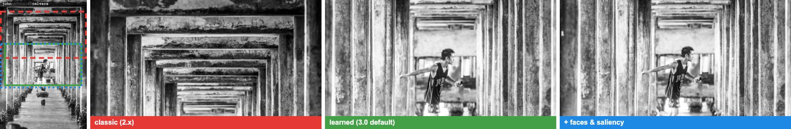
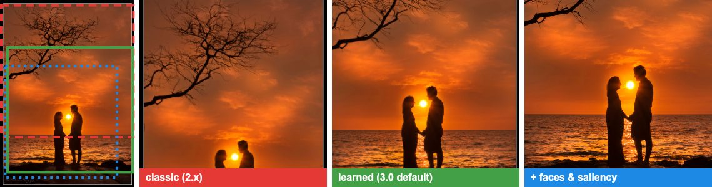
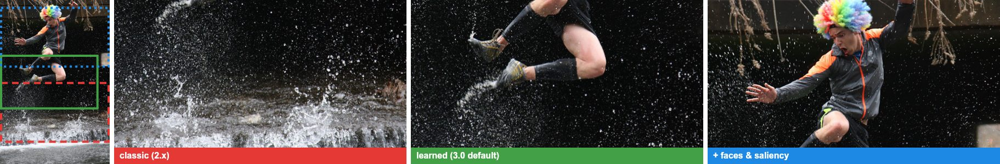
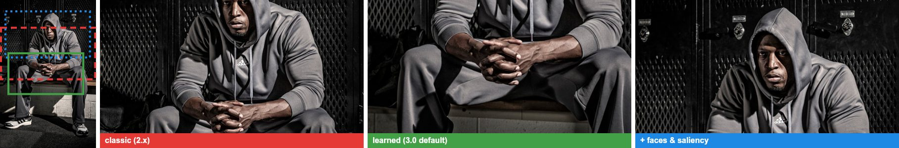
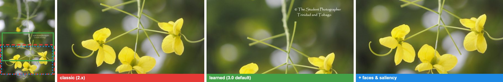

# smartcrop.js [Forked]

[](https://github.com/jauderho/smartcrop.js/actions/workflows/tests.yml)

Smartcrop.js implements an algorithm to find good crops for images.
It can be used in the browser, in node or via a CLI.


Image: [https://www.flickr.com/photos/endogamia/5682480447/](https://www.flickr.com/photos/endogamia/5682480447) by Leon F. Cabeiro (N. Feans), licensed under CC-BY-2.0

## What's better in 3.0

The default crop picker is now a small model trained on human-rated crops.
It ranks and picks crops the way people do far more often than the original
algorithm. These numbers come from held-out benchmark test sets that were never used to train or
tune anything (details in [Results](#results)):

| measure (higher is better)               | original 2.x | 3.0 default (pure JS) | 3.0 + local faces, saliency & CNN |
| ---------------------------------------- | -----------: | --------------------: | --------------------------------: |
| GAICD: ranking agrees with people (SRCC) |        0.369 |      0.623 (**1.7×**) |                  0.795 (**2.2×**) |
| GAICD: best pick is in the human top 5   |        22.4% |      48.0% (**2.1×**) |                  54.0% (**2.4×**) |
| FCDB: overlap with the human crop (IoU)  |        0.718 |         0.744 (+3.6%) |                     0.769 (+7.1%) |
| FLMS: overlap with the human crop (IoU)  |        0.918 |          0.917 (same) |                     0.931 (+1.4%) |

The original algorithm ranked crops worse than always cropping the centre
(GAICD SRCC 0.432); the new default does not. The cost: the learned scorer is
about 10× slower (roughly 90 ms against 9 ms per image in Node), and
`PRESETS.classic` still gives the old crops exactly.

### Before and after

Sample photos from the repository's test images (`examples/images`), cropped
with the original algorithm (red, dashed), the 3.0 default (green, solid) and
the default plus the optional local face and saliency plug-ins (blue, dotted).
They were picked from the sample images where the crops differ most,
including one where the default does worse. Regenerate them with
`bun bench/readme-figures.ts`.

**16:9 banner: the original frames empty corridor; 3.0 finds the person.**

<sub>"Fishing" by John Nathaniel Calvara ([500px](http://500px.com/photo/28155975))</sub>

**16:9 banner: the original fills the frame with shoes; 3.0 keeps the seller.**

<sub>"The Shoe Seller" by Tamal Mitra ([500px](http://500px.com/photo/65144887))</sub>

**Square thumbnail: the original drifts to the branches; 3.0 keeps the couple and the sun.**

<sub>"Lovers" by Photo KWest ([500px](http://500px.com/photo/65210163))</sub>

**16:9 banner: the original picks the splash; 3.0 moves to the runner's legs, and the plug-ins frame the whole runner.**

<sub>"Mile Run Race" by Tim Barnhart ([500px](http://500px.com/photo/65309527))</sub>

**16:9 banner: the pure-JS default settles on the hands; the face plug-in brings back the face.**

<sub>"Joshua Reid" by Jeremy Meier ([500px](http://500px.com/photo/65155627))</sub>

**16:9 banner, a miss: the default loses most of the flowers; the saliency plug-in recovers them.**

<sub>"All for one.. and one for all!" by Sherazade Curfew Ali ([500px](http://500px.com/photo/64948093))</sub>

## Demos

- [Smartcrop.js Test Suite](https://29a.ch/sandbox/2014/smartcrop/examples/testsuite.html), contains over 100 images, **heavy**.
- [Smartcrop.js Test Bed](https://29a.ch/sandbox/2014/smartcrop/examples/testbed.html), allows you to test smartcrop with your own images and different face detection libraries.
- [Automatic Photo transitions](https://29a.ch/sandbox/2014/smartcrop/examples/slideshow.html), automatically creates Ken Burns transitions for a slide show.

## Simple Example

```javascript
// you pass in an image as well as the width & height of the crop you
// want to optimize.
smartcrop.crop(image, { width: 100, height: 100 }).then(function (result) {
  console.log(result);
});
```

Output:

```javascript
// smartcrop will output you its best guess for a crop
// you can now use this data to crop the image.
{topCrop: {x: 300, y: 200, height: 200, width: 200}}
```

## Better crops: the learned scorer (3.0)

This fork adds a learned scorer, the default since 3.0, that picks crops people actually prefer. It
_handily_ beats the original algorithm, which on public benchmarks barely beat
an always-centred crop.

```javascript
const result = await smartcrop.crop(image, {
  width: 1200,
  height: 545,
});
result.topCrop; // { x, y, width, height }
result.position; // { x, y } as CSS object-position percentages
```

For the original algorithm, use `smartcrop.PRESETS.classic` (`{ scorer:
'classic' }`). It reproduces 2.0.5 crops exactly, and a golden test enforces
that.

### Results

Held-out test sets that were never used to train or select anything. IoU is
the overlap with a human crop (higher is better). GAICD measures how well a
method ranks about 86 human-scored crops per photo.

| method                              | GAICD SRCC | GAICD best pick in human top 5 |  FCDB IoU |  FLMS IoU |
| ----------------------------------- | ---------: | -----------------------------: | --------: | --------: |
| always centre                       |      0.432 |                          47.4% |     0.701 |     0.894 |
| original (2.0.5 / `classic`)        |      0.369 |                          22.4% |     0.718 |     0.918 |
| learned, pure JS                    |      0.623 |                          48.0% |     0.744 |     0.917 |
| learned + local faces & saliency    |      0.739 |                          50.4% |     0.765 |     0.925 |
| **learned + faces, saliency & CNN** |  **0.795** |                      **54.0%** | **0.769** | **0.931** |

By content type, on FCDB test (original → learned + faces & saliency):

- people 0.761 → 0.795
- faces 0.764 → 0.803
- landscapes 0.693 → 0.749
- photos with lots of sky 0.705 → 0.753

On wide hero strips, the original tends to sink into textured foreground such
as water, grass or gravel, cutting off sky, skylines and the tops of buildings
and people. The learned scorer keeps them.

### How it works

The original scores a sliding window by Laplacian detail, a skin-colour
detector and saturation. Texture therefore wins over subjects. The learned
scorer instead describes each candidate crop with 141 features, computed from
maps smartcrop already builds and read in constant time from summed-area
tables:

- **Subject:** how much salient mass the crop keeps, and how dense it is.
- **Integrity:** salient mass, face boxes or detail cut by each crop edge.
- **Boundary simplicity** (Fang et al., Adobe, ACM MM 2014): good crop edges
  pass through plain, low-gradient regions.
- **Composition:** subject centroid against the centre and the
  rule-of-thirds points, balance, and the subject's bounding box and margins.
- **Horizon:** the strongest horizontal edge against the ⅓, ½ and ⅔ lines.
- **Faces:** cut fraction, headroom and size, from boost boxes.
- **Geometry:** area ratio, offset and aspect.

A small MLP (141 → 32 → 32 → 1) ranks the candidates. It was trained
pairwise (RankNet) on about 231,000 human-scored crops from GAICD, plus FCDB
crops. The weights ship in the source as 17 KB of float16, which is verified
to make the same choices as the full-precision weights. After retraining (`bun bench/learned/train.ts --write`),
`bun run weights:shrink` picks the smallest encoding (int8, float16 or float32)
that keeps every validation choice unchanged.

The model was selected on validation data only. Things tried and rejected by
measurement:

- blending in the hand-tuned classic score;
- a 5-model ensemble (+0.005 SRCC for 5× the weights);
- a hard content-preservation floor;
- int8 weights, which changed about 1% of choices.

Details: [docs/improvement-plan.md](docs/improvement-plan.md) and
[docs/research-2026.md](docs/research-2026.md).

### Optional local face and saliency models (Node)

For offline or batch cropping, two small ONNX models run locally with
onnxruntime-node, and no image leaves the machine:

- YuNet faces, 0.2 MB;
- U²-Netp salient objects, 4.6 MB;
- crop-tuned MobileNetV2, 14 MB: the ONNX model zoo MobileNetV2 fine-tuned
  for crop ranking ([on Hugging Face](https://huggingface.co/frappe0w/smartcrop-mobilenetv2-crop),
  Apache-2.0). It is the feature backbone of the optional CNN head (below).

They lift the learned scorer to the best numbers in the table above.

On Apple silicon they run on the GPU: small models through onnxruntime's
CoreML provider, models of 50 MB or more with PyTorch on MPS (started through
`uv`, or the Python in `SMARTCROP_MPS_PYTHON`). Anything that can't run there
falls back to the CPU. `SMARTCROP_BACKEND=cpu` gives outputs identical to the
Linux training runs; `mps` or `coreml` force one GPU path.

```sh
bun scripts/fetch-models.ts   # downloads both models (checksummed) into bench/models/
```

```javascript
import { detectFaces, faceBoosts } from './plugins/onnx/faces';
import { saliencyMap } from './plugins/onnx/saliency';

const imageData = ctx.getImageData(0, 0, width, height); // RGBA pixels
const faces = await detectFaces(imageData);
const result = await smartcrop.crop(canvas, {
  width: 1200,
  height: 545,
  boost: faceBoosts(faces, { imageWidth: width, imageHeight: height }),
  importanceMap: await saliencyMap(imageData),
});
```

These are opt-in and not dependencies of the core library, which stays plain
JavaScript for the browser and Node.

#### Optional CNN features

The best results come from adding deep image features. A MobileNetV2
fine-tuned end to end for crop ranking (GAICD test SRCC 0.821, against 0.793
for the frozen ImageNet backbone) produces a feature map once per image
(about 16 ms). The scorer then pools
it inside each candidate crop (RoI) and over the area the crop cuts away
(RoD), as GAIC does, and a second learned head ranks the crops with these
features plus the hand-made ones. The pooling runs in plain JS, and the head
and the backbone's learned projection ship separately as float16
(`src/learned-cnn-weights.ts`, about 320 KB of source, an ensemble of 4 heads). The core bundle does
not include them.

```javascript
import { cnnFeatureMap } from './plugins/onnx/cnn';
import { LEARNED_CNN_PACKED } from './src/learned-cnn-weights';

const result = await smartcrop.crop(canvas, {
  width: 1200,
  height: 545,
  scorer: 'learned',
  boost: faceBoosts(faces, { imageWidth: width, imageHeight: height }),
  importanceMap: await saliencyMap(imageData),
  featureMap: await cnnFeatureMap(imageData),
  cnnModel: LEARNED_CNN_PACKED,
  consensus: 0.2, // optional box voting over the best windows, see below
});
```

The CNN head was trained with faces and saliency present, so use all three
together. Scoring the dense candidate search is slower with it (about 0.3 s
per image), which suits offline precomputation.

`consensus: 0.2` returns the score-weighted mean of the 64 best windows
instead of the single best one. This is box voting, borrowed from object
detection. With the CNN head it was validated on 1,345 held-out images: IoU
+0.005 pooled (95% CI +0.003 to +0.007, p < 0.001), with FCDB +0.006, GAICD
+0.012 and FLMS -0.003. Without the CNN head it has no effect.

### Other additions

- `result.position`: the crop as CSS `object-position` percentages (upstream
  #45, #81, #99).
- `candidates`: score your own list of crops (`result.crops` keeps the input
  order).
- Opt-in classic terms:
  - `luminance: 'rec709'` fixes the luminance typo (#77);
  - `centerWeight`, `textureDamping`, `saliencyWeight` (frequency-tuned
    colour contrast), `borderPenalty`;
  - `importanceMap` with `importanceMapWeight`.
- An evaluation harness in `bench/`:
  - FCDB, FLMS and GAICD benchmarks, with per-content subsets;
  - a parameter tuner;
  - a visual gallery comparing original and improved crops.

  Datasets are downloaded by `scripts/fetch-datasets.ts`, and
  `bun run clean` reclaims the disk space.

## Download/ Installation

This fork is published to npm as [`@jauderho/smartcrop`](https://www.npmjs.com/package/@jauderho/smartcrop)
(the unscoped `smartcrop` package is the original 2.x release):

```sh
npm install @jauderho/smartcrop   # or: bun add @jauderho/smartcrop
```

```javascript
import smartcrop from '@jauderho/smartcrop';
```

The built files are also attached to each [GitHub release](https://github.com/jauderho/smartcrop.js/releases), or build them from source:

```sh
git clone https://github.com/jauderho/smartcrop.js.git
cd smartcrop.js
bun install
bun run build   # writes dist/
```

ES module (`dist/smartcrop.js`):

```javascript
import smartcrop from './smartcrop.js';
```

CommonJS (`dist/smartcrop.cjs`):

```javascript
const smartcrop = require('./smartcrop.cjs');
```

Browser, via a script tag (`dist/smartcrop.iife.js`, defines `window.smartcrop`):

```html
<script src="smartcrop.iife.js"></script>
```

Smartcrop requires a browser or runtime with ES2020 support.
Native Promises are used, so no polyfill is needed. You can still set `smartcrop.Promise` to another promise implementation if you prefer.

## Consider avoiding crops using dont-crop

If you are interested in using smartcrop.js to crop your images you should also consider to avoid cropping them by using [dont-crop](https://github.com/jwagner/dont-crop/).
Dont-crop gives you matching gradients and colors to pad and complement your images.


## Command Line Interface

The [smartcrop-cli](https://github.com/jwagner/smartcrop-cli) offers command line interface to smartcrop.js.

## Node

You can use smartcrop from nodejs via either [smartcrop-gm](https://github.com/jwagner/smartcrop-gm) (which is using image magick via gm) or [smartcrop-sharp](https://github.com/jwagner/smartcrop-sharp) (which is using libvips via sharp).
The [smartcrop-cli](https://github.com/jwagner/smartcrop-cli) can be used as an example of using smartcrop from node.

## Stability

While _smartcrop.js_ is a small personal project it is currently being used on high traffic production sites.
It has a basic set of automated tests and a test coverage of close to 100%.
The tests run with `bun test` against a native canvas ([@napi-rs/canvas](https://github.com/Brooooooklyn/canvas)).
If in any doubt the code is short enough to perform a quick review yourself.

## Algorithm Overview

Smartcrop.js works using fairly dumb image processing. In short:

1. Find edges using laplace
1. Find regions with a color like skin
1. Find regions high in saturation
1. Boost regions as specified by options (for example detected faces)
1. Generate a set of candidate crops using a sliding window
1. Rank them using an importance function to focus the detail in the center
   and avoid it in the edges.
1. Output the candidate crop with the highest rank

## Face detection

The smartcrop algorithm itself is designed to be simple, relatively fast, small and generic.

In many cases it does make sense to add face detection to it to ensure faces get the priority they deserve.

There are multiple javascript libraries which can be easily integrated into smartcrop.js.

- [ccv js](https://github.com/liuliu/ccv) / [jquery.facedetection](http://facedetection.jaysalvat.com/)
- [tracking.js](https://trackingjs.com/examples/face_hello_world.html)
- [opencv.js](https://docs.opencv.org/3.3.1/d5/d10/tutorial_js_root.html)
- [node-opencv](https://github.com/peterbraden/node-opencv)

You can experiment with all of these in the [smartcrop.js testbed](https://29a.ch/sandbox/2014/smartcrop/examples/testbed.html)

On the client side I would recommend using tracking.js because it's small and simple. Opencv.js is compiled from c++ and very heavy (~7.6MB of javascript + 900kb of data).
jquery.facedetection has dependency on jquery and from my limited experience seems to perform worse than the others.

On the server side node-opencv can be quicker but comes with some [annoying issues](https://github.com/peterbraden/node-opencv/issues/415) as well.

It's also worth noting that all of these libraries are based on the now dated [viola-jones](https://en.wikipedia.org/wiki/Viola%E2%80%93Jones_object_detection_framework) object detection framework.
It would be interesting to see how more [state of the art](http://mmlab.ie.cuhk.edu.hk/projects/WIDERFace/WiderFace_Results.html) techniques could be implemented in browser friendly javascript.

## Supported Module Formats

- ES module (`dist/smartcrop.js`)
- CommonJS (`dist/smartcrop.cjs`)
- browser global / `window.smartcrop` (`dist/smartcrop.iife.js`)

## Supported Browsers

Any browser with ES2020 and [canvas](http://caniuse.com/canvas) support.
Internet Explorer is not supported, use smartcrop 2.x if you need it.

## API

### smartcrop.crop(image, options)

Find the best crop for _image_ using _options_.

**image:** anything ctx.drawImage() accepts, usually HTMLImageElement, HTMLCanvasElement or HTMLVideoElement.

Keep in mind that [origin policies](https://en.wikipedia.org/wiki/Same-origin_policy) apply to the image source.
You may not use cross-domain images without [CORS](https://en.wikipedia.org/wiki/Cross-origin_resource_sharing) clearance.

**options:** [cropOptions](#cropOptions)

**returns:** A promise for a [cropResult](#cropResult).

### cropOptions

**minScale:** minimal scale of the crop rect, set to 1.0 to prevent smaller than necessary crops (lowers the risk of chopping things off). Defaults to 1.0 for the classic scorer and 0.4 for the learned scorer (the default), which may pick a tighter crop; crops that would need upscaling are never picked when `width`/`height` are given.

**width:** width of the crop you want to use.

**height:** height of the crop you want to use.

**boost:** optional array of regions whose 'interestingness' you want to boost (for example faces). See [boost](#boost);

**ruleOfThirds:** optional boolean if set to false it will turn off the rule of thirds composition weight.

**scorer:** `'learned'` (default since 3.0; see [the learned scorer](#better-crops-the-learned-scorer-30)) or `'classic'` (the original algorithm, also `smartcrop.PRESETS.classic`). `PRESETS.next` is kept as an alias of the default.

**importanceMap:** optional saliency or importance map `{ width, height, data }` (any size, values ≥ 0) used by the learned scorer and by `importanceMapWeight` in classic mode.

**debug _(internal)_:** if true, the cropResult will contain debugOutput, debugOptions and debugTopCrop as well as the complete crops array.

There are many more (for now undocumented) options available.
Check the [source](src/smartcrop.ts) and be advised that they might change in the future.

### cropResult

Result of the promise returned by smartcrop.crop.

```javascript
{
  topCrop: crop,
  position: { x: 50, y: 31.2 } // CSS object-position percentages of topCrop
}
```

### crop

An individual crop.

```javascript
{
  x: 11, // pixels from the left side
  y: 20, // pixels from the top
  width: 1, // pixels
  height: 1 // pixels
}
```

### boost

Describes a region to boost. A usage example of this is to take
into account faces in the image. See [smartcrop-cli](https://github.com/jwagner/smartcrop-cli) for an example on how to integrate face detection.

```javascript
{
  x: 11, // pixels from the left side
  y: 20, // pixels from the top
  width: 32, // pixels
  height: 32, // pixels
  weight: 1 // in the range [0, 1]
}
```

Note that the impact the boost has is proportional to it's weight and area.

## Tests

Development uses [bun](https://bun.sh):

```sh
bun install
bun test        # unit tests
bun check       # type check
bun run lint    # eslint
bun fmt         # format
bun run start   # serve the examples at http://localhost:8000
```

## Benchmark

There are benchmarks for both the browser (test/benchmark.html) and bun (`bun run bench`)
both powered by [benchmark.js](http://benchmarkjs.com).

If you just want some rough numbers: It takes **< 20 ms** to find a **square crop** of a **640x427px** picture on an i7.
In other words, it's fine to run it on one image, it's suboptimal to run it on an entire gallery on page load.

## Contributors

- [Christian Muehlhaeuser](https://github.com/muesli)

## Ports, Alternatives

- [connect-thumbs](https://github.com/inadarei/connect-thumbs) Middleware for connect.js that supports smartcrop.js by [Irakli Nadareishvili](https://github.com/inadarei/connect-thumbs)
- [smartcrop-java](https://github.com/QuadFlask/smartcrop-java) by [QuadFlask](https://github.com/QuadFlask/)
- [smartcrop-android](https://github.com/QuadFlask/smartcrop-android) by [QuadFlask](https://github.com/QuadFlask/)
- [smartcrop.go](https://github.com/muesli/smartcrop) by [Christian Muehlhaeuser](https://github.com/muesli)
- [smartcrop.py](https://github.com/hhatto/smartcrop.py) by [Hideo Hattori](http://www.hexacosa.net/about/)
- [smartcrop-rails](https://github.com/sadiqmmm/smartcrop-rails) smartcrop wrapped in a ruby gem by [Mohammed Sadiq](https://github.com/sadiqmmm/)
- [smartcrop.net](https://github.com/softawaregmbh/smartcrop.net) c# .net port by [softaware gmbh](https://www.softaware.at/)
- [dont-crop](https://github.com/jwagner/dont-crop/) a library to avoid cropping by padding images with matching colors or gradients

## Version history

### 3.0.0

- Published to npm as `@jauderho/smartcrop`.
- Breaking: the learned crop scorer, trained on human-rated crops, is now the default. It is about 10x slower than the classic scorer (roughly 90 ms vs 9 ms per image in Node) and searches tighter crops (`minScale` 0.4). `PRESETS.classic` (`scorer: 'classic'`) keeps the original crops exactly.
- Optional local ONNX face, saliency and CNN-feature plug-ins (`plugins/onnx`), with pinned model checksums. They live in the repository and are not part of the npm package yet.
- `result.position`, `candidates`, and opt-in classic terms (`luminance`, `centerWeight`, `textureDamping`, `saliencyWeight`, `borderPenalty`, `importanceMap`).
- Benchmark, tuning and gallery tooling in `bench/`.
- TypeScript source (`src/smartcrop.ts`) and generated type definitions.
- ES module, CommonJS and browser builds in `dist/` with a package.json `exports` map.
- Removed the AMD module format and the root `smartcrop.js`.
- ES2020 baseline, Internet Explorer is no longer supported.
- Image operations now consistently use `smartcrop.Promise`.
- bun based development tooling (`bun test`, `bun check`, `bun fmt`).

### 2.0.5

Fix `TS1046: Top-level declarations in .d.ts files must start with either a 'declare' or 'export' modifier.`.

### 2.0.4

Typescript type definitions.

### 2.0.2

In short: It's a lot faster when calculating bigger crops.
The quality of the crops should be comparable but the results
are going to be different so this will be a major release.

### 1.1.1

Removed useless files from npm package.

### 1.1

Creating github releases. Added options.input which is getting passed along to iop.open.

### 1.0

Refactoring/cleanup to make it easier to use with node.js (dropping the node-canvas dependency) and enable support for boosts which can be used to do face detection.
This is a 1.0 in the semantic meaning (denoting backwards incompatible API changes).
It does not denote a finished product.

## License

Copyright (c) 2018 Jonas Wagner, licensed under the MIT License (enclosed)

Fork changes copyright (c) 2026 Jauder Ho, same licence. The learned scorer
weights were trained on research datasets (GAICD, FCDB) whose licence terms are
not stated; see [NOTICE](NOTICE).
